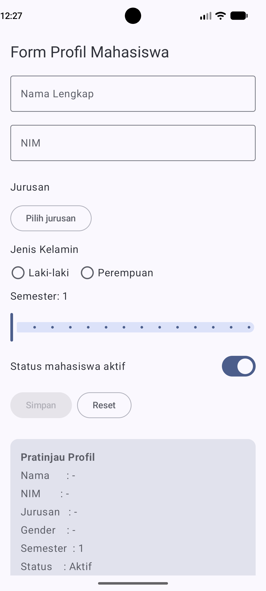
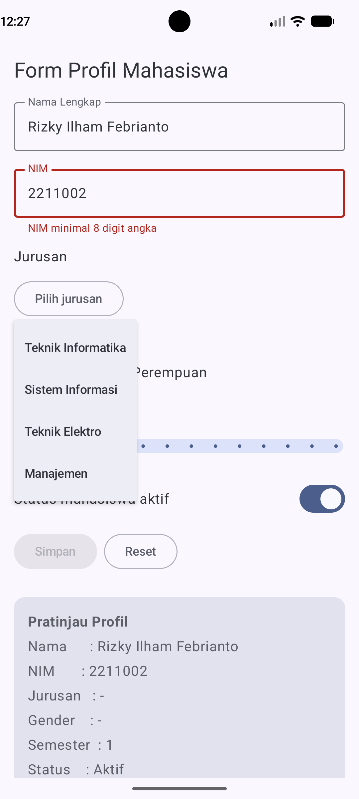
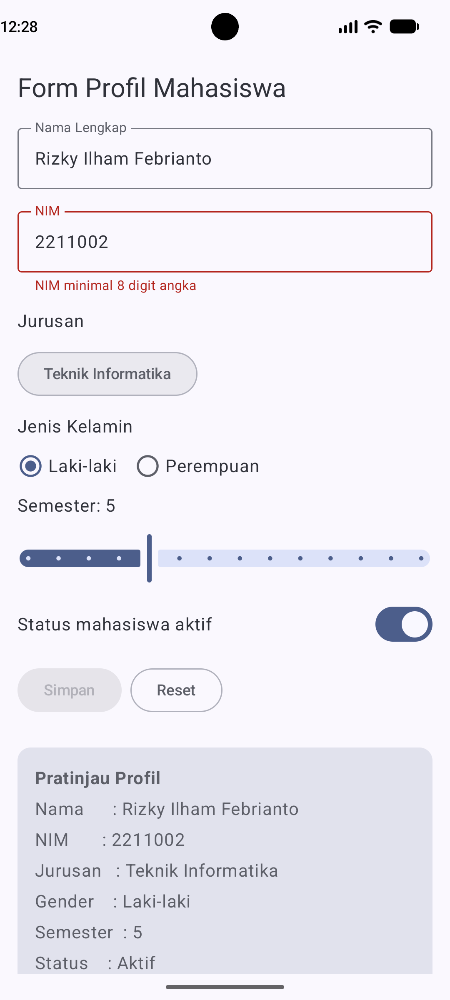

# Profil Mahasiswa (Jetpack Compose)

Aplikasi Android native berbasis Kotlin dan Jetpack Compose untuk tugas pertama mata kuliah
Pemrograman Aplikasi Bergerak.

## Deskripsi
Aplikasi berisi form profil mahasiswa (nama, NIM, jurusan, jenis kelamin, semester yang ditempuh,
status aktif) dengan pratinjau profil yang berubah secara real-time.

## Konsep yang Diterapkan
- **State**: `mutableStateOf` & `rememberSaveable` menyimpan data input.
- **Event**: `onValueChange`, `onClick`, `onCheckedChange` mengubah state.
- **Recomposition**: UI diperbarui otomatis saat state berubah.

## Fitur
- Validasi NIM (minimal 8 digit angka)
- Tombol Simpan aktif hanya jika form valid
- Pratinjau profil real-time
- Tombol Reset

## Teknologi
Kotlin, Jetpack Compose, Material 3, Android Studio

## Cara Menjalankan
1. Clone repo: `git clone https://github.com/Rizky-Ilham-Febrianto/pab-form-profil-mahasiswa-2211002.git`
2. Buka di Android Studio, tunggu Gradle Sync
3. Jalankan di emulator atau perangkat fisik

## Screenshot

## Pembuat
Rizky Ilham Febrianto - 2211002